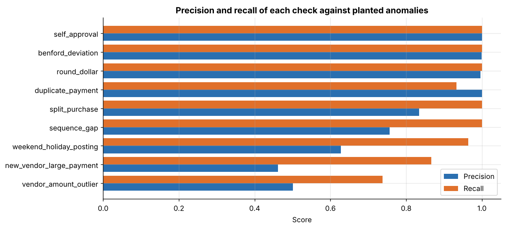
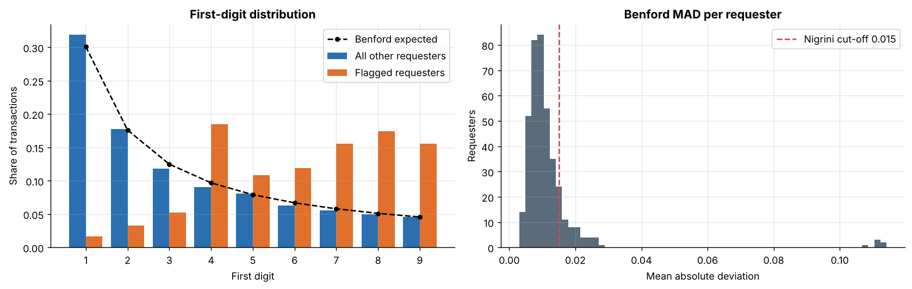
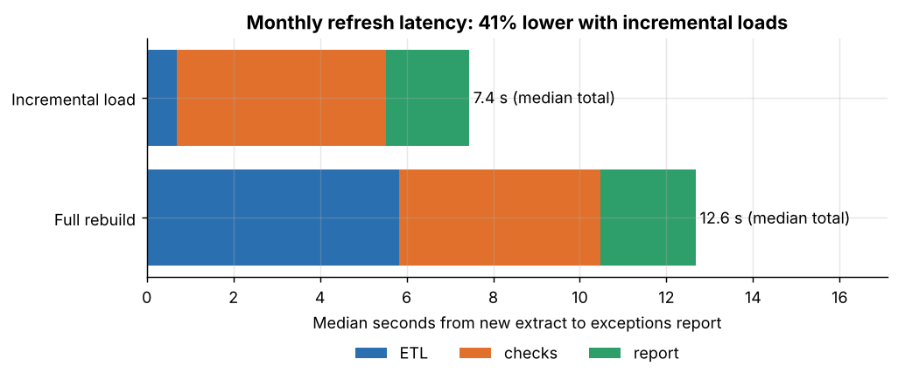

# Automated Financial Anomaly Detection for Internal Audit

Python and SQL ETL pipeline that loads $830M of accounts-payable and purchasing-card transactions into SQLite, runs nine automated statistical and rule-based anomaly checks, and produces a ranked exceptions report in about 13 seconds.

## Business goal

A university internal audit office reviewed AP vouchers and P-card spend by hand: pulling extracts into spreadsheets and testing samples, about 8 analyst-hours per review cycle. The goal was to replace that with an automated pipeline that tests every transaction against a standard set of audit checks (duplicates, split purchases, Benford's law, segregation of duties and others) and hands the reviewer a prioritised list of exceptions.

This repository rebuilds that approach end to end on synthetic data, and because the anomalies are planted, it can measure how well each check works.

## Data

All data is **synthetic**, produced by `src/generate_data.py` (fixed seed). It models a fictional university's ledger over three fiscal years (July 2022 to June 2025): **418,070 raw transaction rows**, of which 417,470 pass validation, totalling **$830.9M**.

| File | Rows | Description |
|---|---|---|
| `transactions_FY2023.csv` ... `FY2025.csv` | 418,070 | One row per AP voucher or P-card transaction (split by fiscal year to keep files under 20 MB) |
| `vendors.csv` | 3,390 | Vendor master with creation date (includes vendors created during the period) |
| `departments.csv` | 35 | Departments and colleges |
| `employees.csv` | 500 | Requesters and approvers (staff, managers, department heads) |
| `accounts.csv` | 24 | GL accounts and account groups |
| `holidays.csv` | 36 | University holidays |
| `anomaly_labels.csv` | 5,717 | Ground truth for the planted anomalies (used only for evaluation) |

Transaction schema:

| Column | Description |
|---|---|
| `txn_id` | Transaction id |
| `voucher_no` | Sequential AP voucher number per fiscal year (blank for P-card) |
| `source` | `AP` or `PCARD` |
| `invoice_no` | Vendor invoice number (card reference for P-card) |
| `invoice_date`, `posting_date` | Invoice and general-ledger posting dates |
| `vendor_id`, `dept_id`, `account_code` | Keys to the master files |
| `requester_id`, `approver_id` | Employee who requested and employee who approved |
| `amount` | Amount in USD (negative for credit memos) |

**How it was generated.** Vendors have their own log-normal amount distributions and Zipf-like popularity; AP invoices post on business days only, P-card transactions settle any day; requesters belong to departments and approvals route to a manager below $5,000 and to the department head at or above it. Nine anomaly types are then planted, each matching one check: 635 duplicate payments (45% with the invoice number re-keyed), 682 split-purchase pieces just under the $5,000 and $25,000 thresholds, 417 weekend or holiday postings, 6 requesters with fabricated amounts (2,686 transactions), 517 round-dollar payments, 259 vendor amount outliers, 82 large payments to newly created shell vendors, 299 self-approvals and 140 deleted vouchers. Realistic noise is added on purpose: fixed round-amount stipends, a Sunday fiscal year-end close, legitimate large first orders from new vendors, and cancelled vouchers. Data-quality defects (missing approvers, blank amounts, unparseable dates, unknown vendors, untidy keys, duplicate extract records) are injected for the ETL to catch.

## Approach

1. **ETL and data quality** (`notebooks/01_etl_data_quality.ipynb`, `src/etl.py`). Extract the fiscal-year files and masters, validate every row (fix what is fixable, quarantine what is not, with a reason), reconcile rows and dollars back to the source, load to SQLite and create the SQL views in `src/sql/views.sql`.
2. **The nine checks** (`notebooks/02_anomaly_checks.ipynb`, `src/checks.py`). Seven checks are SQL views (window functions, self-joins, calendar joins); two are statistical tests in Python. Each check is explained, run, and scored for precision and recall against the planted labels.

   | # | Check | Method |
   |---|---|---|
   | 1 | Duplicate payments | Same vendor, amount and normalised invoice number (SQL window) |
   | 2 | Split purchases | 2+ payments at 75-100% of a $5k/$25k threshold, same requester and vendor within 7 days, sum over threshold (SQL self-join) |
   | 3 | Weekend / holiday postings | AP posting on Saturday, Sunday or a university holiday (SQL) |
   | 4 | Benford's law | First-digit test per requester: MAD > 0.015 and chi-square p < 0.001 (Python, scipy) |
   | 5 | Round-dollar amounts | Exact multiples of $1,000, stipend accounts excluded (SQL) |
   | 6 | Vendor amount outliers | Robust z-score of log(amount) > 4 using vendor median and MAD (Python) |
   | 7 | New-vendor large payments | $25k+ within 90 days of vendor creation (SQL) |
   | 8 | Self-approval | Requester equals approver (SQL) |
   | 9 | Voucher sequence gaps | Jumps in the AP voucher sequence via `LAG()` (SQL) |

3. **Exceptions report and timing** (`notebooks/03_exceptions_report_and_timing.ipynb`). Run the full pipeline end to end, write a ranked exceptions report (`data/processed/exceptions_report.csv`) with a weighted risk score, time the automated cycle, and compare monthly refresh latency for a full rebuild versus an incremental load of the new month.

## Results

| Metric | Result |
|---|---|
| Transactions tested | 417,470 (100% of loaded rows, no sampling), $830.9M |
| Automated review cycle (extract to ranked report) | 12.9 s (0.21 min) vs 8-hour manual baseline: 99.96% less time |
| Monthly refresh latency, incremental vs full rebuild | 12.6 s to 7.4 s: 41.1% lower |
| Planted anomalous transactions caught by at least one check | 5,584 of 5,717 (97.7%) |
| Share of flagged transactions that are planted anomalies | 92.0% (6,067 flagged, 1.45% of the ledger) |
| Macro-average precision / recall across the 9 checks | 0.797 / 0.944 |
| Value of transactions in the exceptions report | $49,963,530 |

Per-check precision and recall (row level, against the anomaly type each check targets):

| Check | Flagged | Precision | Recall |
|---|---|---|---|
| Duplicate payments | 592 | 1.000 | 0.932 |
| Split purchases | 818 | 0.834 | 1.000 |
| Weekend / holiday postings | 641 | 0.627 | 0.964 |
| Benford deviation | 2,688 | 0.999 | 1.000 |
| Round-dollar amounts | 519 | 0.996 | 1.000 |
| Vendor amount outliers | 381 | 0.501 | 0.737 |
| New-vendor large payments | 154 | 0.461 | 0.866 |
| Self-approval | 299 | 1.000 | 1.000 |
| Voucher sequence gaps | 185 | 0.757 | 1.000 |



What the numbers say:

* Many "false positives" still point at real problems: 165 of the vendor-outlier check's 190 non-target flags are other planted anomalies, and all 236 clean weekend flags sit on one date (the Sunday 30 June 2024 year-end close), which a documented-close-date exception would remove.
* The misses are explainable: duplicates re-keyed with transposed digits (43) and shell-vendor payments made after the 90-day window (11).
* The 8-hour manual baseline is the office's stated effort per cycle, an input assumption rather than something measured here. The automated figure is measured wall-clock time on the 4-core build machine and covers producing the exceptions report, not the reviewer's follow-up on it.





## Repository structure

```
audit-anomaly-detection/
  README.md
  requirements.txt
  LICENSE
  data/
    raw/                  synthetic extracts, masters and anomaly labels
    processed/            exceptions report, per-check summary, precision/recall, timings
  src/
    generate_data.py      synthetic ledger generator with planted anomalies
    etl.py                extract -> validate -> load (full and incremental)
    sql/views.sql         SQL views behind seven of the checks
    checks.py             the nine checks, exceptions report builder
    evaluation.py         precision / recall against planted labels
  notebooks/
    01_etl_data_quality.ipynb
    02_anomaly_checks.ipynb
    03_exceptions_report_and_timing.ipynb
  reports/figures/        charts used in this README
```

The SQLite database is written to `data/warehouse/audit.db` and is not committed; it is rebuilt in a few seconds.

## How to reproduce

```bash
pip install -r requirements.txt
python src/generate_data.py          # writes data/raw/
python src/etl.py                    # optional: builds data/warehouse/audit.db and prints the DQ log
cd notebooks
jupyter nbconvert --to notebook --execute --inplace 01_etl_data_quality.ipynb 02_anomaly_checks.ipynb 03_exceptions_report_and_timing.ipynb
```

Timings in notebook 03 depend on the machine, so they will differ slightly from run to run; everything else is deterministic.

## Tech stack

Python (pandas, NumPy, SciPy), SQL on SQLite (views, window functions, self-joins), matplotlib, Jupyter.

## Note on data

This project is modelled on work I did for a university internal audit office. All data in this repository is synthetic and generated by `src/generate_data.py`; it contains no real transactions, vendors, employees or institutional data, and vendor and employee names are fictional. The results describe the synthetic dataset and the planted anomalies, not any real organisation.
